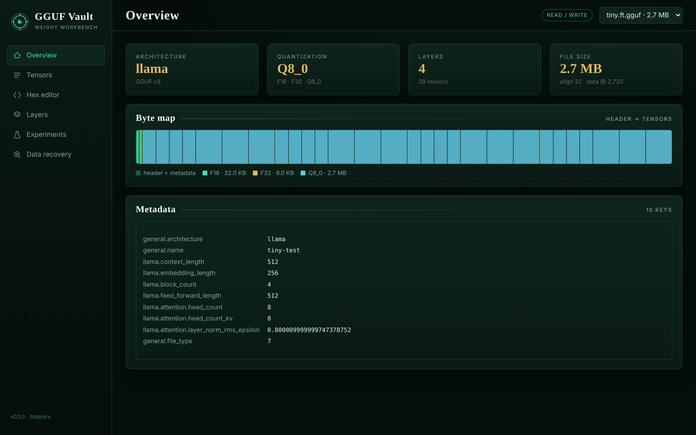
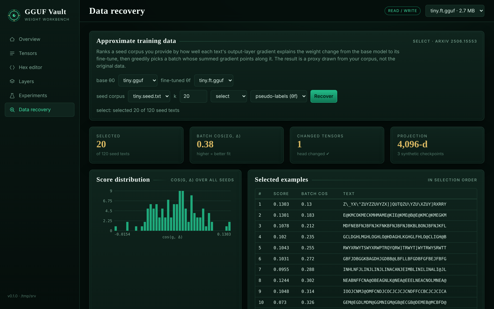
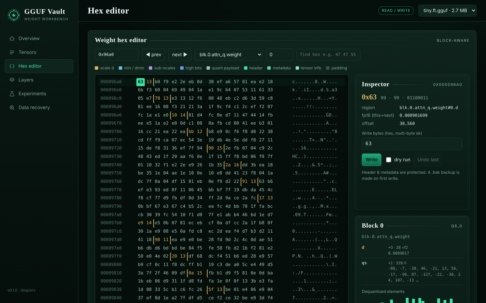
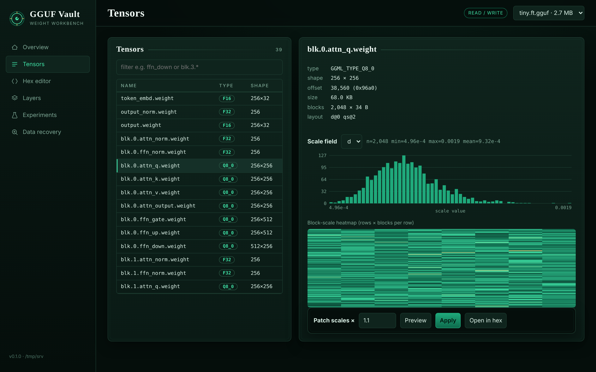
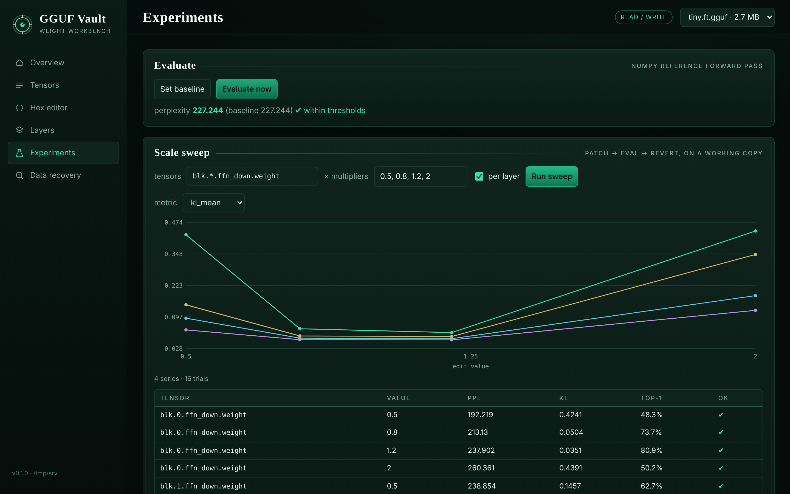
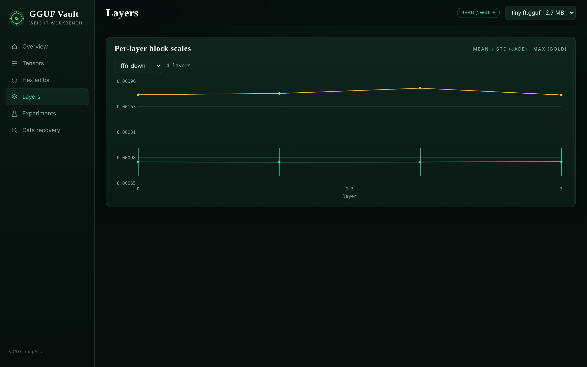

# jade-guff-hacker

Inspect, patch, steer and evaluate **GGUF** quantized language models (llama.cpp format) without
re-quantizing or training. Works on the memory-mapped file: block scales and raw bytes are edited
in place, with backups, an undo journal and range checks.

```
gguf-hack ─┬─ inspector   mmap header / KV / tensor table, zero-copy structured block views
           ├─ quant_codec NumPy dequantizers (bit-exact vs reference gguf) + scale extraction
           ├─ patcher     in-place scale & byte edits: .bak, journal, validation, msync, dry-run
           ├─ tracer      numpy reference forward pass, residual capture, steering, control-vector export
           ├─ evaluator   perplexity, KL vs baseline, weight drift, pass/fail thresholds
           ├─ harness     patch → eval → revert loops, sweeps, YAML/JSON specs  (programmatic API)
           ├─ viz         matplotlib plots + self-contained HTML report
           ├─ hexedit     block-aware annotated hex view / poke
           ├─ datarecover approximate fine-tuning data from a base/fine-tuned pair (SELECT)
           └─ web         REST API + single-page dashboard (stdlib only)
```

## Install

```bash
pip install -e ".[full]"        # numpy only is required; gguf, tqdm, matplotlib, pyyaml are optional extras
pytest                          # 43 tests
```

## Command line

```bash
gguf-hack make-test-model tiny.gguf                      # tiny synthetic llama model to play with
gguf-hack inspect --model tiny.gguf --tensor blk.1.ffn_down.weight --json
gguf-hack unpack-scales --model tiny.gguf --tensor blk.1.ffn_down.weight --out scales.npy
gguf-hack patch-scale --model tiny.gguf --tensor "blk.*.ffn_down.weight" --multiplier 1.1 --dry-run
gguf-hack patch-scale --model tiny.gguf --tensor blk.1.ffn_down.weight --scale-map new.npy   # writes .bak first
gguf-hack restore --model tiny.gguf                      # back to the .bak
gguf-hack hexdump --model tiny.gguf --tensor blk.0.attn_q.weight --block 3
gguf-hack poke --model tiny.gguf --offset 0x5660 --hex "00 3c" --dry-run
gguf-hack eval --model tiny.gguf --save-baseline base.json
gguf-hack eval --model patched.gguf --baseline base.json          # exit code 2 on regression
gguf-hack steer --model tiny.gguf --vector v.npy --layer 2 --alpha 1.5 --export cv.gguf  # llama.cpp control vector
gguf-hack harness examples/sweep.yaml
gguf-hack viz report --model tiny.gguf --out report.html
gguf-hack recover-data --base base.gguf --model ft.gguf --seed-corpus pool.txt --k 100 --out picked.jsonl
gguf-hack serve --root ./models                          # dashboard on http://127.0.0.1:8765
```

## Python API

```python
import gguf_weight_hacker as gh

with gh.open_gguf("model.gguf") as r:                  # zero-copy, read-only mmap
    r.summary(); r["blk.14.attn_v.weight"].to_dict()
    scales = r.scales("blk.14.ffn_down.weight")        # float32 copy of the fp16 'd' values
    blocks = r.blocks("blk.14.ffn_down.weight")        # structured array: blocks["d"], blocks["qs"] ...

with gh.open_gguf("model.gguf", writable=True) as r:   # in-place edits
    p = gh.Patcher(r)                                  # .bak + journal + validation
    p.patch_scale("blk.14.ffn_down.weight", multiplier=1.05)
    p.revert()

with gh.Harness("model.gguf", workdir="runs/x") as h:  # always works on a copy
    h.baseline()
    h.sweep("blk.*.ffn_down.weight", "multiplier", [0.9, 1.1], per_layer=True)
    h.save()
```

See [`examples/quickstart.py`](examples/quickstart.py) for a full tour.

## Approximating training data from weights

`datarecover` implements a simplified version of **SELECT** from *Approximating Language Model
Training Data from Weights* (Morris et al., 2025, [arXiv:2506.15553](https://arxiv.org/abs/2506.15553)).
Given a base model θ0 and its fine-tune θf, plus a **public seed corpus you supply**, it ranks every
seed text by how well its output-layer gradient explains Δ = θf − θ0, then greedily builds a batch
whose *summed* gradient points along Δ. The result is the subset of your corpus that best stands in
for the fine-tuning data. It **does not** reconstruct the actual training data.

```python
from gguf_weight_hacker.datarecover import recover, compare_methods
r = recover("base.gguf", "finetuned.gguf", "seed_pool.txt", k=100)      # method="select"
r.save("picked.jsonl"); r.info["final_batch_cos"]
compare_methods("base.gguf", "finetuned.gguf", "seed_pool.txt", k=50, reference=held_out_texts)
```

How it works: per-example gradient of the output head in closed form, `−Σ_t (p_t − e_{y_t}) ⊗ h_t`,
compressed with a Kronecker Johnson–Lindenstrauss projection (default 4096-d, as in the paper) so the
`vocab × n_embd` gradient is never built; pseudo-labels from θf; P synthetic checkpoints interpolated
between θ0 and θf; greedy selection maximising cos(Σ g, Δ). Baselines: `topk`, `loss_drop`, `random`.
Corpora: `.txt` (one per line), `.jsonl` (`{"text": …}`) or `.json`.

Demo (`gguf-hack make-test-model tiny.gguf --finetune-demo` writes a base model, a head-only
fine-tune on "topic A", and a 50/50 A/B seed pool). Picks from the fine-tune's topic in the top 20:

| method | random | loss_drop | topk | **select** |
|---|---|---|---|---|
| topic-A picks / 20 | 9 | 18 | 15 | **17** |

Limits: only the output head is used, so a fine-tune that froze the head (e.g. many LoRA setups) gives
no signal (the tool warns). Assumes SGD-like updates; Adam fine-tunes align more weakly. The NumPy
forward pass makes this practical for small models or a few thousand seed texts. Not validated on real
fine-tunes here.

## Dashboard








`gguf-hack serve --root ./models` — Overview (byte map, metadata), Tensors (scale histogram/heatmap,
patch with preview), **Hex editor** (every byte colour-coded by block field, decoded inspector,
multi-byte write, dry-run, undo, find), Layers, Experiments (baseline, live sweeps), **Data recovery**
(pick base, fine-tune and a seed corpus from `--root`; ranked picks and score distribution; allowed in
`--readonly` mode since it never writes).

Safety: binds to localhost; refuses non-local binds without `--token`; only `.gguf` files under
`--root`; `Host` header check; writes require a custom header; `--readonly` disables all edits;
all model-derived text is rendered with `textContent`.
Theme: all colours/fonts are tokens in `gguf_weight_hacker/web/static/theme.css`.

## Safety rules for edits

* Writes are refused inside the header / KV / tensor-info region and past EOF.
* Scale edits reject NaN/Inf, values > fp16 max, and changes > 10⁴× the original.
* A `.bak` copy is made before the first write; every write is journaled and reversible.
* `msync` after every edit. The harness verifies a full-file fingerprint after each revert.

## Supported types

Native NumPy dequantizers (verified bit-exact against the reference `gguf` package): F32, F16, BF16,
Q4_0, Q4_1, Q5_0, Q5_1, Q8_0, Q4_K, Q6_K. All other types (Q2_K, Q3_K, Q5_K, IQ*, TQ*, MXFP4) have
parsed block layouts (scale patching and hex annotation work) and dequantize through the reference
`gguf` package when installed. Q4_K_M and similar are *mixes* of tensor types, not a tensor type.

## Limitations (read these)

* **Steering inside llama.cpp:** hooking `llama_build_graph` through ctypes isn't possible — graph
  construction is internal to the C++ library. Runtime steering is implemented in the NumPy reference
  model (small models), and for llama.cpp you export a **control-vector GGUF** (`steer --export`)
  and run `llama-cli --control-vector`. The control-vector layer indexing should be checked against
  your llama.cpp version.
* The NumPy forward pass covers llama-style architectures and is meant for small models / tests, not throughput.
* `LlamaCppBackend` (llama-cpp-python scoring) is untested here.
* Patching K-quant `scales` (6-bit packed sub-scales) or quant nibbles is only supported as raw byte
  edits in the hex editor; the scale-patching commands target the fp16 super-block scales.
* Test models are synthetic and random, so perplexity numbers are meaningless — only the deltas are.
